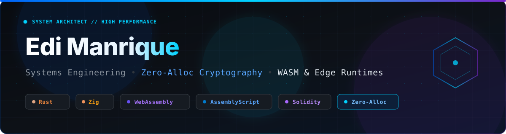

<div align="center">

<!-- NATIVE HIGH-PERFORMANCE VECTOR BANNER -->


<p align="center">
  <a href="https://github.com/edison-manrique">
    
  </a>
</p>

<p align="center">
  
  
  
</p>

---

</div>

## ⚡ About Me

I am a **Systems Architect & Low-Level Engineer** dedicated to building ultra-high-performance cryptographic engines, WebAssembly runtimes, and edge-native intelligence. 

My work focuses on eliminating runtime overhead through **zero-allocation memory architectures**, **SIMD/WebGPU acceleration**, and **deterministic computation** across decentralized protocols and modern systems. I leverage AI as a primary orchestrator for deep technical infrastructure, system verification, and knowledge synthesis.

```rust
struct Engineer {
    name: &'static str,
    location: &'static str,
    stack: [&'static str; 5],
    principles: [&'static str; 3],
}

const EDI: Engineer = Engineer {
    name: "Edison Manrique Chocce",
    location: "Peru 🇵🇪",
    stack: ["Rust", "Zig", "AssemblyScript", "Solidity", "TypeScript"],
    principles: [
        "Zero memory allocations in critical paths",
        "Deterministic cross-runtime isomorphism (Node/Bun/Deno/Browser)",
        "Rigorous verification against formal cryptographic vectors",
    ],
};
```

---

## 🚀 Featured Flagship Projects

<table>
  <tr>
    <td width="50%" valign="top">
      <h3 align="center">⚡ blockchain-wasm</h3>
      <p align="center">
        <a href="https://github.com/edison-manrique/blockchain-wasm">
          
          
        </a>
      </p>
      <p>Single-binary, zero-allocation WebAssembly cryptographic engine for Bitcoin & Ethereum wallets. Includes secp256k1, BIP-32/39/44, Schnorr (BIP-340), ECDSA, ECDH, Taproot, WIF, and addresses without any runtime heap allocation or <code>memory.grow</code>.</p>
      <p>🔗 <a href="https://edison-manrique.github.io/blockchain-wasm/"><b>Live Interactive Playground →</b></a></p>
    </td>
    <td width="50%" valign="top">
      <h3 align="center">🎙️ fast-tiny-tts</h3>
      <p align="center">
        <a href="https://github.com/edison-manrique/fast-tiny-tts">
          
          
        </a>
      </p>
      <p>Ultra-compact, real-time English Neural TTS (4.5M params, 24kHz) running 100% locally on CPU, mobile, and client browsers via ONNX, Pyodide, and Web Workers. Zero server round-trips with instant voice synthesis.</p>
      <p>🔗 <a href="https://edison-manrique.github.io/fast-tiny-tts/"><b>Live Web Demo →</b></a></p>
    </td>
  </tr>
  <tr>
    <td width="50%" valign="top">
      <h3 align="center">🔐 Cryptographic WASM Suites</h3>
      <p>
        
        
        
      </p>
      <p>Specialized low-level cryptographic building blocks: <b>2fa-wasm</b> (RFC-6238 TOTP/HOTP), <b>aead-wasm</b> (authenticated ciphers), and <b>sha2-wasm</b> for maximum hashing throughput in sandboxed environments.</p>
    </td>
    <td width="50%" valign="top">
      <h3 align="center">⛓️ Web3 & Protocol Infrastructure</h3>
      <p>
        
        
      </p>
      <p>Protocol-level design, secure EVM smart contracts, gas-optimized state structures, and multi-chain execution layers spanning Bitcoin scripts, Taproot trees, and Ethereum rollups.</p>
    </td>
  </tr>
</table>

---

## 🛠️ Technical Stack & Tooling

<div align="center">

| Domain | Technologies & Frameworks |
| :--- | :--- |
| **Low-Level & Systems** |     |
| **Blockchain & Web3** |     |
| **High-Performance Web** |     |
| **Edge AI & Computing** |    |

</div>

---

## 📊 GitHub Analytics & Architecture Activity

<div align="center">

<table border="0">
  <tr>
    <td align="center">
      
    </td>
    <td align="center">
      
    </td>
  </tr>
  <tr>
    <td colspan="2" align="center">
      
    </td>
  </tr>
</table>

</div>

---

## 🏛️ Engineering Philosophy

> *"Abstraction without performance penalty is art; performance without correctness is vanity."*

- **⚡ Zero-Allocation Guarantee:** Critical algorithms avoid dynamic heap allocation, preventing GC stutter and unpredictability in latency-sensitive applications.
- **🔒 Mathematical Rigor:** Cryptographic primitives are verified against BIP test vectors, golden Python implementations, and algebraic curve constants.
- **🌐 Isomorphic Runtime Design:** Every library is engineered from day zero to run identically on Node.js, Bun, Deno, and modern browsers without transpiler bloat.
- **🤖 Intelligence-Driven Systems:** Leveraging advanced LLM agents and neuro-symbolic reasoning to synthesize complex codebases and perform continuous verification.

---

<div align="center">

### 🤝 Connect & Collaborate

[](https://github.com/edison-manrique)
[](mailto:edison.manrique.chocce@gmail.com)

</div>
